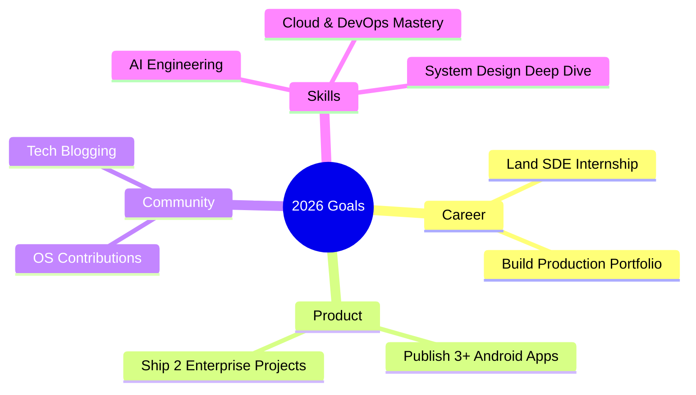

<div align="center">


<br/>

<p>
  <a href="https://www.linkedin.com/in/manojs2007/"></a>
  <a href="mailto:manoj.nive2007@gmail.com"></a>
  <a href="https://github.com/LORDXMANOJ"></a>
</p>

<p>
  
  
  
  
  
</p>

</div>

---

### 👨‍💻 About Me

> Computer Science Engineering student passionate about building reliable, scalable and user-friendly products that solve real problems. From enterprise audit platforms to Android apps — I love shipping end-to-end solutions.

```typescript
const manoj = {
  role: "Full Stack & Android Developer",
  education: "B.E Computer Science @ Nehru Institute of Engineering & Technology",
  cgpa: "8.7 / 10",
  location: "Tamil Nadu, India",
  workingOn: ["Enterprise Web Platforms", "Android Apps with Jetpack Compose", "Cloud-Native Backends"],
  learning: ["System Design", "AI Engineering", "Advanced Cloud Architecture"],
  askMeAbout: ["React", "ASP.NET Core", "Android (Kotlin)", "PostgreSQL", "Docker"],
  funFact: "I turn coffee into code and ideas into products.",
  hireable: true
};
```

<div align="center">

| 🎯 **Core Strengths** | 🛠️ **What I Build** | 🌱 **Currently Exploring** |
|:---:|:---:|:---:|
| Clean Architecture & Scalable APIs | Full-Stack Web Applications | AI Integration in Full-Stack Apps |
| Android UI/UX with Modern Toolkits | Enterprise Dashboards & Analytics | Microservices & Kubernetes |
| Problem Solving & Ownership | Mobile-First Product Experiences | System Design Patterns |

</div>

---

### 🛠️ Tech Stack

<div align="center">

**Languages**
<br/>

<br/><br/>

**Frontend**
<br/>

<br/><br/>

**Backend & Frameworks**
<br/>

<br/><br/>

**Mobile**
<br/>

<br/>


<br/><br/>

**Databases & Cloud**
<br/>

<br/><br/>

**Tools & Workflow**
<br/>


</div>

<br/>

<details>
<summary><b>📦 Full Stack Breakdown</b></summary>
<br/>

- **Frontend:** React.js, HTML5, CSS3, Tailwind CSS, Vite, Responsive Design
- **Backend:** ASP.NET Core, Node.js, Express.js, Django, REST APIs, JWT Auth
- **Mobile:** Kotlin, Jetpack Compose, Material Design 3, WorkManager, DataStore, MVVM
- **Databases:** PostgreSQL, MySQL, MongoDB, Firebase, DataStore Preferences
- **DevOps & Tools:** Docker, Git, GitHub Actions, Postman, Swagger
- **Concepts:** Clean Architecture, RBAC, Background Jobs, File Handling (PDF/Excel)

</details>

---

### 🚀 Featured Projects

#### 📱 1. PocketGuardian — Smart Student Expense Tracker
> An Android app designed to simplify student financial tracking with modern UI and automation.

**Stack:** `Kotlin` `Jetpack Compose` `MVVM` `Room` `DataStore` `WorkManager` `QR UPI`

- 💳 QR-based UPI payment flow for instant tracking
- 📊 Visual analytics & categorized expense insights  
- 🔔 Smart reminders using WorkManager for recurring expenses
- 🎨 100% Jetpack Compose UI with Material 3 theming
- 💾 Offline-first with DataStore & local persistence

`[Source Code](https://github.com/LORDXMANOJ)` • `Android`

---

#### 🏭 2. 5S Audit Management System — Enterprise Platform
> Production-grade audit platform for manufacturing compliance — React + ASP.NET Core + PostgreSQL

**Stack:** `React` `ASP.NET Core` `PostgreSQL` `JWT` `Docker` `EPPlus` `iTextSharp`

- 🔐 Secure JWT Authentication with Role-Based Access Control (Admin/Auditor/Viewer)
- 📈 Interactive Analytics Dashboard with audit scoring & trend analysis
- 📄 Automated PDF & Excel report generation
- 🐳 Fully Dockerized deployment with PostgreSQL persistence
- ⚙️ Background jobs for notifications & scheduled audits
- 🏢 Enterprise-ready: Multi-department, multi-location support

`[Live Demo](#)` • `[Backend](https://github.com/LORDXMANOJ)` • Enterprise Project

---

#### 💻 3. ManojOS (Quantum Core) — Browser Operating System
> A concept OS in the browser — desktop experience, window manager, and AI assistant.

**Stack:** `React` `Node.js` `MongoDB` `Express` `Tailwind` `AI Integration`

- 🖥️ Draggable windows, file explorer, terminal emulator
- 🤖 Integrated AI assistant for system interactions
- 🎨 Multiple themes, wallpapers, and customizable desktop
- 📁 Virtual file system with MongoDB persistence
- ⚡ Fast Vite-powered frontend with optimized state management

`[Live Demo](https://github.com/LORDXMANOJ)` • `[Source](https://github.com/LORDXMANOJ)` • Concept OS

---

<div align="center">

### Want to see more?
<a href="https://github.com/LORDXMANOJ?tab=repositories"></a>

</div>

---

### 📜 Certifications & Learning

| Certification | Issuer | Domain |
|:---|:---|:---|
| **Networking Essentials** | Cisco Networking Academy | Networking & Infrastructure |
| **Cloud Computing** | NPTEL — IIT | Cloud Architecture |
| **Internet of Things (IoT)** | NPTEL — IIT | Embedded & IoT Systems |
| **Programming & Databases** | Infosys Springboard | Full-Stack Foundations |
| **Job Simulation** | Tata Forage | Business & Tech |
| **AI for Beginners** | HP LIFE | Artificial Intelligence |

> Continuously learning via hands-on building — currently diving deeper into **System Design** and **AI Engineering**.

---

### 🏆 Achievements

<div align="center">

| Award | Event | Highlights |
|:---|:---|:---|
| 🥇 **Winner — Poster Making** | Technical Symposium | Recognized for technical visualization & communication |
| 🥇 **Winner — Paper Presentation** | Technical Symposium | Presented innovative solution to industry panel |
| 🎓 **Technical & Placement Program** | NIET | Selected for advanced training program |

</div>

---

### 📊 GitHub Analytics

<div align="center">


<br/>

<table>
<tr>
<td width="50%">


</td>
<td width="50%">


</td>
</tr>
<tr>
<td colspan="2">


</td>
</tr>
</table>


</div>

---

### 🎯 2026 Roadmap



- 🚀 Land a Software Engineering Internship at a product-based company
- 📱 Publish 2+ Android apps on Play Store with 1k+ downloads
- 🌍 50+ meaningful contributions to open-source projects
- 🤖 Build and deploy 2 AI-integrated full-stack applications
- ☁️ Get certified in AWS / Azure and master cloud-native patterns

---

### 🤝 Let's Connect & Collaborate

<div align="center">

If you're looking for a **passionate developer who ships real products**, let's talk!

<br/><br/>

<a href="mailto:manoj.nive2007@gmail.com"></a>
<a href="https://www.linkedin.com/in/manojs2007/"></a>

<br/><br/>

| Platform | Handle / Link |
|:---|:---|
| 📧 **Email** | `manoj.nive2007@gmail.com` |
| 💼 **LinkedIn** | [linkedin.com/in/manojs2007](https://www.linkedin.com/in/manojs2007/) |
| 💻 **GitHub** | [github.com/LORDXMANOJ](https://github.com/LORDXMANOJ) |
| 📍 **Location** | Tamil Nadu, India — Open to Remote |

<br/>

**Open to:** `Internships` • `Freelance Projects` • `Open Source Collaborations` • `Hackathons`

</div>

---

<div align="center">

### 💡 *"First, solve the problem. Then, write the code."* — John Johnson


</div>
